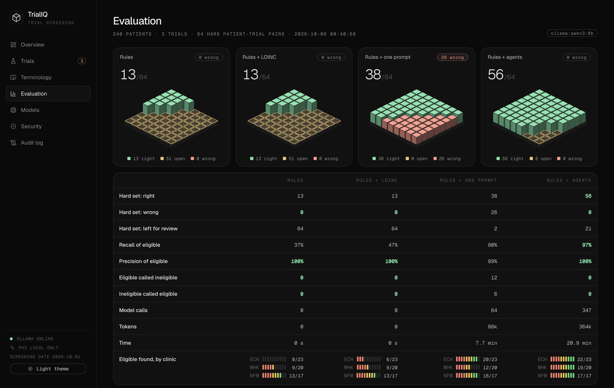

# TrialIQ


[](LICENSE)

A diabetes trial wants patients with HbA1c between 7% and 10.5%. At a safety-net clinic, the lab sends HbA1c under
its own code, in mmol/mol, with no LOINC code. A database query never sees those patients. Their heart failure
history is in a discharge summary, and the medicine list still shows a drug that a note says was stopped six weeks
ago.

**TrialIQ screens a health system's patients for clinical trials the way a careful coordinator would.** Rules decide
what structured data can decide. Agents read the notes only for the facts that are still open, code checks every
quote, number and date, and a person approves each referral.



## Follow one patient

1. **The trial.** The criteria agents turn the eligibility text from ClinicalTrials.gov into computable rules. A
   reviewer agent compares them with the protocol, and the study coordinator approves them.
2. **The lab codes.** The LOINC mapper agent proposes a LOINC code for each local lab code, such as `ECH-POCA1C`. A
   person approves each mapping. Now the rules can read that clinic's HbA1c.
3. **The rules.** The prescreen engine decides age, coded diagnoses, medicines and coded labs, with no model. Each
   criterion is met, not met, or open.
4. **The notes.** For the open facts only, the chart agent searches and reads the patient's notes and answers with a
   quote, a value, a unit and a date.
5. **The checks.** Code rejects a quote that is not in the note and a value that is not in the quote, converts
   64 mmol/mol to 8.0%, and leaves an event without a date open. The evidence reviewer looks for negation
   ("no hypoglycemia unawareness"), family history ("mother with type 1 diabetes") and old events.
6. **The verdict.** Code applies the thresholds. A fact that nobody can prove goes to a person, not to a guess.
7. **The referral.** A short draft to the patient's primary care doctor waits for the coordinator's approval.

| | Decides | Never decides |
| --- | --- | --- |
| Prescreen engine | Structured data with unit conversion | Facts that only notes hold |
| Chart agent | Which note says what | Thresholds, units, time windows |
| Code guards | Whether a quote, value, unit and date are real | Clinical meaning |
| Evidence reviewer | Whether the quote supports the finding | Thresholds |
| Coordinator | Criteria, mappings, each referral | |

## Four methods on the same 240 patients

Three real Indiana trials, 240 synthetic patients at three clinics, and the same local model, `qwen3:8b`, for all
model work. The hard set is the 64 patient-trial pairs that rules cannot decide.
[Full report](reports/evals-20261006-0109.md).

|| Rules | + LOINC mappings | + one prompt per patient | + agent team |
| --- | --- | --- | --- | --- |
| Hard set: right / wrong | 13 / 0 | 13 / 0 | 38 / **26** | **56 / 0** |
| Recall of eligible patients | 0.37 | 0.47 | 0.80 | **0.97** |
| Precision of eligible patients | 1.00 | 1.00 | 0.89 | **1.00** |
| Right on trap patients | 42% | 42% | 67% | **94%** |
| Eligible found at the safety-net clinic | 0/23 | 6/23 | 20/23 | **22/23** |
| Time for the 64 hard pairs | < 1 s | < 1 s | 7.7 min | 20.9 min |

Rules alone never make a wrong call, but they miss every eligible patient at the safety-net clinic. One prompt per
patient reads the notes but makes 26 wrong calls; on the heart failure trial it rejected all 10 eligible patients.
The agent team made no wrong call, at about 4 times the tokens of one prompt.

## Privacy

Patient notes go only to the local model unless a person switches cloud models on. Each agent has a fixed list of
tools. A screen removes note text that reads as an instruction to a model. The audit log is a SHA-256 hash chain.
MCP tools return verdicts and evidence, never whole charts.

## Data sources and licenses

All patients are synthetic, made by `backend/app/ehr/generate.py` from a fixed seed. No real patient data is in this
project.

| Source | Use | Terms |
| --- | --- | --- |
| [ClinicalTrials.gov](https://clinicaltrials.gov) API | Trial records; snapshots of 3 trials from October 2026 | U.S. government public data. ClinicalTrials.gov does not endorse this project |
| ICD-10-CM | Diagnosis codes | Public domain, CDC National Center for Health Statistics |
| RxNorm, through [RxNav](https://lhncbc.nlm.nih.gov/RxNav/) | Medicine ingredient codes | Free to use, U.S. National Library of Medicine |
| LOINC, through [NLM Clinical Tables](https://clinicaltables.nlm.nih.gov/) | Lab test codes and names | Free to use under the [LOINC license](https://loinc.org/license/) |

This product uses publicly available data from the U.S. National Library of Medicine (NLM), National Institutes of
Health, Department of Health and Human Services; NLM is not responsible for the product and does not endorse or
recommend this or any other product.

The trial snapshots hold the eligibility text, the sponsor and the site names. They hold no contact persons.

## Try it

```bash
ollama pull qwen3:8b
./run.sh            # web app on http://localhost:5180
./run.sh test       # 57 tests with a scripted model
./run.sh eval       # the evaluation, about an hour on qwen3:8b
```

Or `docker compose up --build`, then http://localhost:8020. Cloud model keys go on the **Models** page.

A short tour: approve the LOINC mappings on **Terminology**, run the heart failure trial NCT06736574 on **Trials**,
open a patient on **Candidates** and click a quote, then approve the drafts on **Referrals**.

## Code map

```
backend/app/ehr/        synthetic EHR, code systems, gold answers
backend/app/trials/     ClinicalTrials.gov client and trial snapshots
backend/app/engine.py   prescreen engine
backend/app/agent/      chart agent, reviewer, protocol agents, guards, LangGraph graph
backend/app/security.py tool permissions, injection screen, audit chain
backend/evals/          the four-method evaluation and a prompt injection test
frontend/               React + Vite
```

## Open questions

- The synthetic notes come from templates. Real notes are longer and messier; the next test is Synthea or an OMOP
  extract with coordinators' chart review as the gold answer.
- An 8B model takes about 20 s per open patient on a laptop, and its draft criteria need a coordinator's review.
- "Eligible" means eligible on the criteria that a chart can show. Consent and the screening visit stay with the
  study team.
